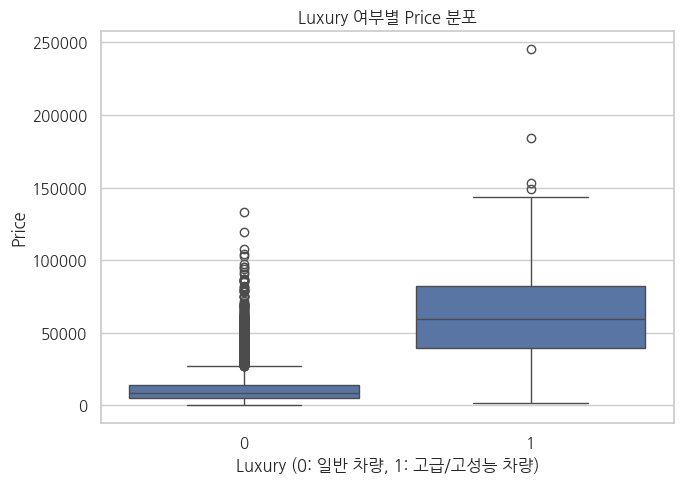
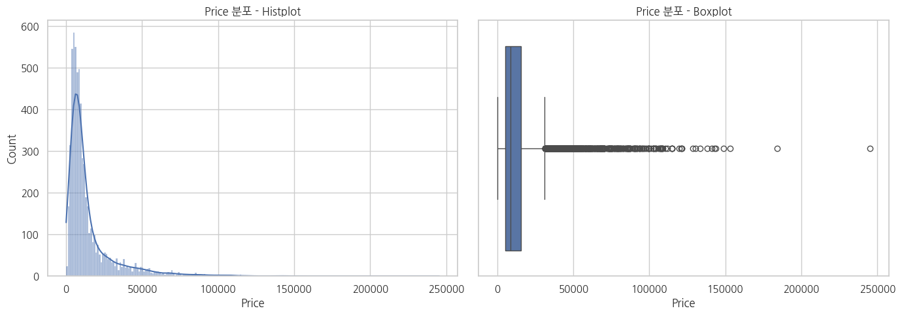
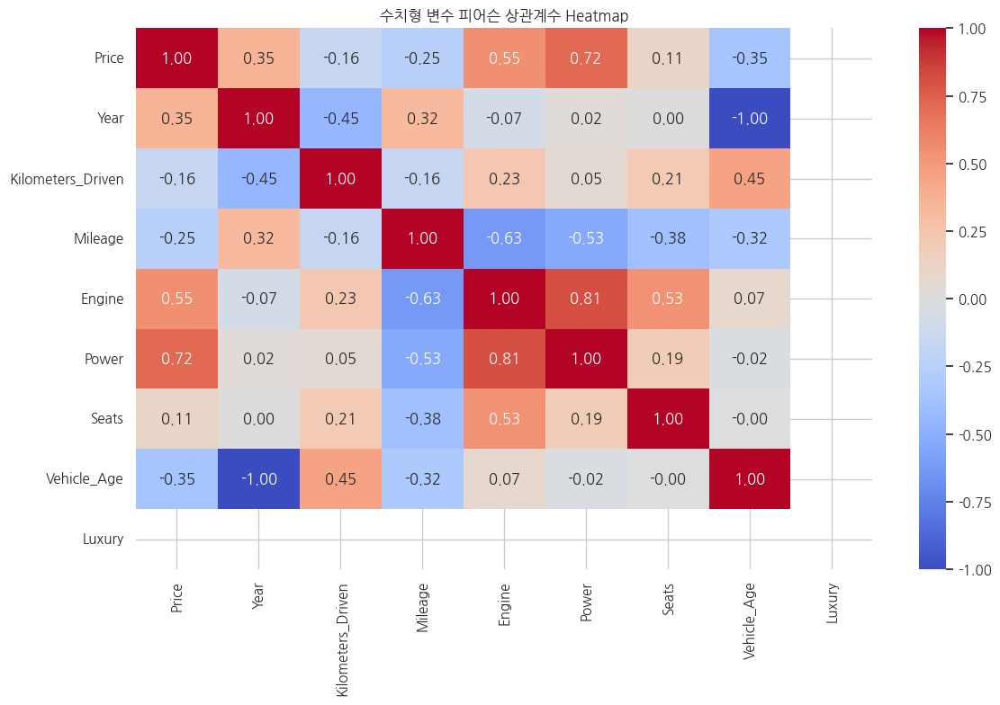

# 인도 중고차 가격 예측: 도메인 기반 정제와 일반 차량 시세 모델

POSCO 청년 AI·Big Data 아카데미 33기 **종합실습 Ⅰ** 팀 프로젝트 (B1조, 6인, 2026.05.27 ~ 05.29)

인도 중고차 7,253대의 브랜드·연식·주행거리·엔진·출력 등으로 **중고차 가격(Price)을 예측**했습니다. 이상치를 기계적으로 지우는 대신 **도메인 기준으로 오류만 제거**했습니다. 엔진·출력이 극단적으로 큰 차량은 `Luxury`로 따로 분리해, **일반 차량 시세 모델**을 만들었습니다.

| 항목 | 내용 |
|---|---|
| 데이터 | 7,253대 × 13개 변수 → 정제 후 일반 차량 **5,871대** (아카데미 제공) |
| 목표 변수 | `Price` (단위: 천 원) |
| 모델 | 선형회귀, 랜덤포레스트 (둘 다 `log1p(Price)`로 학습, 원래 단위로 복원해 평가) |
| 최종 모델 | **랜덤포레스트**: MAE 2,112 (약 211만 원), R² 0.876 |
| 분석 | ANOVA, 피어슨 상관, VIF, One-hot 인코딩, 파이프라인 전처리 |
| 도구 | Python, pandas, scipy, statsmodels, scikit-learn (Google Colab) |

---

## 내 역할 (김성호)

- **모델링**: 선형회귀와 랜덤포레스트 성능 비교
- **발표 자료(PPT) 작성**

> 이 저장소의 노트북은 **팀 최종본**이며 본인 단독 코드가 아닙니다. 데이터 정제와 Luxury 분리 코드의 최종 수정은 다른 팀원이 맡았습니다.

---

## 분석 흐름

```
단위 제거·Brand 추출 → 도메인 기준 오류 제거 → Price 결측 제외 → New_Price 삭제
  → 파생변수 (Vehicle_Age, Luxury) → Luxury 차량 분리
  → EDA (ANOVA·상관·VIF) → 선형회귀 vs 랜덤포레스트 → 최종 모델 선정
```

### 1. 데이터 정제
| 단계 | 처리 | 남은 행 |
|---|---|---|
| 원본 | — | 7,253 |
| 단위 제거 | `Engine`(CC), `Power`(bhp), `Mileage`(kmpl)에서 숫자만 추출 | — |
| 중복 제거 | 완전히 같은 행 1건 | 7,252 |
| 주행거리 오류 | 600만 km 이상 1건 (2017년식 BMW X5, 650만 km) | 7,251 |
| 비정상 값 | 연비 0 (81건), 좌석 수 0 (1건) | 7,169 |
| 목표값 결측 | `Price` 없는 1,039건은 학습·평가에서 제외 | 6,130 |
| 결측 많은 열 | `New_Price` 결측 86% → 열 삭제 | — |
| Luxury 분리 | 고배기량·고출력 차량 259대를 따로 보관 | **5,871** |

### 2. 파생변수
| 변수 | 정의 |
|---|---|
| `Brand` | 차량명(`Name`)의 첫 단어 |
| `Vehicle_Age` | 2026 − 연식(`Year`) |
| `Luxury` | 엔진 ≥ 3,123cc **또는** 출력 ≥ 232.75bhp. 각 변수의 IQR 상한(Q3 + 1.5×IQR)이 기준 |

`Luxury`는 실제 고급차 등급이나 브랜드 분류가 아니라, 엔진·출력 기준으로 만든 구분입니다.



### 3. 탐색 분석 (일반 차량 5,871대)



가격이 오른쪽으로 크게 치우쳐 있어서, 모델 학습 때는 `log1p(Price)`를 썼습니다. 평가는 원래 단위로 되돌린 예측값 기준입니다.

- **ANOVA**: 브랜드·변속기·연료·지역·소유자 유형 모두 가격 평균 차이가 유의함 (p < 0.05)
- **상관분석** (가격 기준): 출력 0.72, 엔진 0.55, 차령 −0.35. 엔진과 출력끼리는 0.81로 높음
- **VIF**: `Year`와 `Vehicle_Age`는 완전히 같은 정보라 VIF가 무한대 → 모델에서는 `Year`를 뺌



### 4. 모델 비교 (학습 4,696대 / 검증 1,175대)

| 모델 | MAE | RMSE | R² |
|---|---|---|---|
| **랜덤포레스트** (트리 300개) | **2,112.13** | **4,579.96** | **0.8762** |
| 선형회귀 | 2,377.24 | 4,587.90 | 0.8758 |

R²는 두 모델이 거의 같았습니다. 평균 오차(MAE)가 약 26만 원 더 작은 **랜덤포레스트**를 골랐습니다.

- 입력: 수치형 6개 (주행거리, 연비, 엔진, 출력, 좌석 수, 차령) + 범주형 5개 (지역, 연료, 변속기, 소유자 유형, 브랜드)
- 결측은 학습 데이터 기준으로 수치형은 중앙값, 범주형은 최빈값으로 채움
- 범주형은 One-hot 인코딩. 선형회귀만 수치형에 표준화 적용
- 전처리를 파이프라인에 넣어, 분할한 뒤 학습 데이터로만 기준을 계산함

---

## 시행착오와 판단 과정

노트북의 수정 이력 주석과 팀 PPT 피드백 문서(5/29) 기준으로 정리했습니다.

**① IQR로 지우지 않고 도메인 기준을 택했다**
처음에는 IQR 기준으로 이상치를 지운 버전도 함께 만들었습니다. 그런데 가격 상위 차량은 레인지로버, 람보르기니처럼 실제로 비싼 차였습니다. IQR로 지우면 정상 데이터를 버리게 된다고 판단했습니다. 그래서 IQR은 확인만 하고, 650만 km 주행, 연비 0, 좌석 0처럼 **현실적으로 불가능한 값만** 지웠습니다.

**② `New_Price`를 살리려다 포기했다**
신차 가격은 중고차 가격과 직접 관련될 수 있어서, Lakh·Crore로 섞인 단위를 하나로 맞추는 코드를 짰습니다. 하지만 86%가 결측이라 열을 삭제했습니다. 단위 변환 코드는 노트북에 주석으로 남아 있습니다.

**③ Luxury 기준을 두 번 고쳤다**
처음에는 엔진과 출력이 **둘 다** 75번째 백분위수 이상인 차량으로 정의했습니다. 최종본에서는 IQR 상한 기준으로 바꾸고, **둘 중 하나만** 넘어도 Luxury로 보도록 바꿨습니다. 발표 자료에 적힌 이유는 이렇습니다. 엔진과 출력은 서로 상관이 매우 높으니, 둘 중 어느 쪽이든 극단값인 차량을 하나로 묶어 이상치 문제와 다중공선성을 함께 줄이려는 것이었습니다.

**④ 시장을 둘로 나눠 모델링하려다 일반 차량에 집중했다**
처음에는 일반 차량과 Luxury 차량을 따로 모델링했습니다(듀얼 마켓). 최종본에서는 이 부분을 끄고, Luxury 259대는 분리만 해두고 일반 차량 5,871대로 모델을 평가했습니다.

**⑤ 발표 자료를 코드와 대조했다**
발표 자료 검토 중 코드에 없는 '핵심 영향 인자' 슬라이드와 실제와 다른 상관계수 숫자를 찾았습니다. 슬라이드는 지우고, 숫자는 수정 대상으로 표시했습니다.

---

## 한계

- **고가·고성능 차량(259대)은 예측 범위 밖입니다.** 가격 편차가 큰 차량을 빼고 평가한 결과라, 전체 중고차 시장 성능으로 볼 수 없습니다.
- 검증은 80:20 **한 번 분할한 결과**입니다. 교차검증이나 별도 테스트셋 평가는 하지 않았습니다. 두 모델의 R² 차이(0.0004)는 분할에 따라 바뀔 수 있는 수준입니다.
- 랜덤포레스트 변수 중요도는 계산하지 않았습니다.

---

> 이 README의 수치는 모두 노트북 실행 결과 기준입니다.

## 저장소 구조

```
├── README.md
├── notebooks/
│   └── used_car_price_prediction.ipynb   # 팀 최종본 (실행 결과 포함)
├── docs/
│   └── final_presentation.pdf            # 최종 발표 자료 (15p)
├── images/                               # README용 그래프 (노트북 출력에서 추출)
└── data/
    └── README.md                         # 데이터 미포함 안내
```

노트북은 최종본 그대로이며, 수정 이력 주석 5곳의 팀원 이름만 "팀원"으로 바꿨습니다.

## 실행 방법

1. Google Colab에서 노트북을 엽니다.
2. 데이터 불러오기 셀을 실행하면 파일 선택 창이 뜹니다. 여기서 `Car.csv`를 업로드합니다. 데이터는 이 저장소에 포함되어 있지 않습니다 ([`data/README.md`](data/README.md) 참고).
3. 첫 셀부터 순서대로 실행합니다. 한글 폰트(나눔고딕)는 노트북 안에서 설치됩니다.
